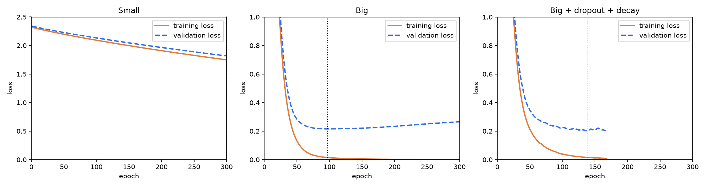

# Project 1 report: little data, big model (Courier company)

## Results (from results/results.csv)

| Model | Final training loss | Best validation loss (epoch) | Test accuracy |
|---|---|---|---|
| Small | 1.749 | 1.818 (300) | 0.660 |
| Big | 0.001 | 0.216 (97) | 0.957 |
| Big + dropout + decay | 0.009 | 0.202 (138) | 0.965 |

## What each curve shows
- Small: underfitting. Both the training loss and the validation loss stay high and were still going down at epoch 300. The model is too simple.
- Big: overfitting. The training loss goes to almost 0, but the validation loss is lowest at epoch 97 and then goes up again.
- Big + dropout + decay: healthy. The validation loss stays flat at about 0.2 and does not go up. Early stopping ended the training at epoch 168.

## Decision
We ship the Big + dropout + decay model because it has the lowest validation loss and the highest test accuracy (0.965), and the thing that would help most next is more labelled digits, because 200 images is too little data.